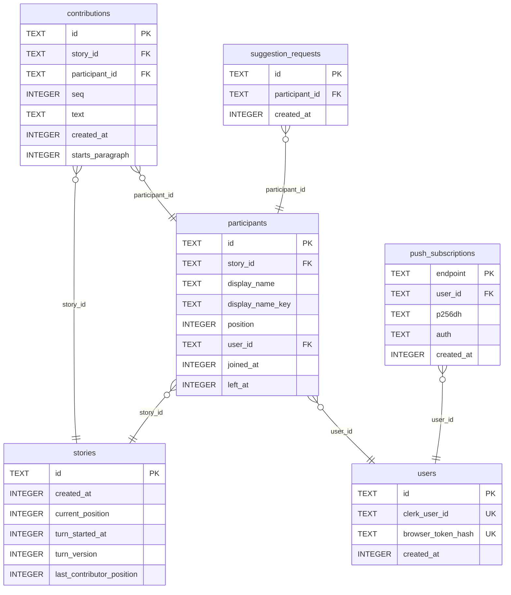

# Database

> Generated by `pnpm db:docs` from the migrations and `src/worker/db/tableSchemas.ts`. Do not edit it by hand.
>
> Descriptions come from the table schemas; columns, types, keys and indexes come from the migrated database.
>
> Required counts a primary key as required, as the app does; SQLite lets a non-INTEGER primary key hold NULL.



## contributions

### Columns

| Column             | Type    | Required | Default | Description |
| ------------------ | ------- | -------- | ------- | ----------- |
| `id`               | TEXT    | yes      |         |             |
| `story_id`         | TEXT    | yes      |         |             |
| `participant_id`   | TEXT    | yes      |         |             |
| `seq`              | INTEGER | yes      |         |             |
| `text`             | TEXT    | yes      |         |             |
| `created_at`       | INTEGER | yes      |         |             |
| `starts_paragraph` | INTEGER | yes      | `1`     |             |

### Indexes

| Name                               | Kind              | Columns       | Condition |
| ---------------------------------- | ----------------- | ------------- | --------- |
| `sqlite_autoindex_contributions_1` | primary key       | id            |           |
| `sqlite_autoindex_contributions_2` | unique constraint | story_id, seq |           |

<details>
<summary>CREATE TABLE statement</summary>

```sql
CREATE TABLE contributions (
  id TEXT PRIMARY KEY,
  story_id TEXT NOT NULL REFERENCES stories (id),
  participant_id TEXT NOT NULL REFERENCES participants (id),
  seq INTEGER NOT NULL,
  text TEXT NOT NULL,
  created_at INTEGER NOT NULL, starts_paragraph INTEGER NOT NULL DEFAULT 1 CHECK (starts_paragraph IN (0, 1)),
  UNIQUE (story_id, seq)
)
```

</details>

## participants

### Columns

| Column             | Type    | Required | Default | Description |
| ------------------ | ------- | -------- | ------- | ----------- |
| `id`               | TEXT    | yes      |         |             |
| `story_id`         | TEXT    | yes      |         |             |
| `display_name`     | TEXT    | yes      |         |             |
| `display_name_key` | TEXT    | yes      |         |             |
| `position`         | INTEGER | yes      |         |             |
| `user_id`          | TEXT    | yes      |         |             |
| `joined_at`        | INTEGER | yes      |         |             |
| `left_at`          | INTEGER | no       |         |             |

### Indexes

| Name                              | Kind              | Columns                    | Condition         |
| --------------------------------- | ----------------- | -------------------------- | ----------------- |
| `participants_active_by_user`     | unique index      | story_id, user_id          | `left_at IS NULL` |
| `participants_by_user`            | index             | user_id                    |                   |
| `sqlite_autoindex_participants_1` | primary key       | id                         |                   |
| `sqlite_autoindex_participants_2` | unique constraint | story_id, position         |                   |
| `sqlite_autoindex_participants_3` | unique constraint | story_id, display_name_key |                   |

<details>
<summary>CREATE TABLE statement</summary>

```sql
CREATE TABLE participants (
  id TEXT PRIMARY KEY,
  story_id TEXT NOT NULL REFERENCES stories (id),
  display_name TEXT NOT NULL,
  display_name_key TEXT NOT NULL,
  position INTEGER NOT NULL,
  user_id TEXT NOT NULL REFERENCES users (id),
  joined_at INTEGER NOT NULL,
  left_at INTEGER,
  UNIQUE (story_id, position),
  UNIQUE (story_id, display_name_key)
)
```

</details>

## push_subscriptions

### Columns

| Column       | Type    | Required | Default | Description |
| ------------ | ------- | -------- | ------- | ----------- |
| `endpoint`   | TEXT    | yes      |         |             |
| `user_id`    | TEXT    | yes      |         |             |
| `p256dh`     | TEXT    | yes      |         |             |
| `auth`       | TEXT    | yes      |         |             |
| `created_at` | INTEGER | yes      |         |             |

### Indexes

| Name                                    | Kind        | Columns  | Condition |
| --------------------------------------- | ----------- | -------- | --------- |
| `push_subscriptions_by_user`            | index       | user_id  |           |
| `sqlite_autoindex_push_subscriptions_1` | primary key | endpoint |           |

<details>
<summary>CREATE TABLE statement</summary>

```sql
CREATE TABLE "push_subscriptions" (
  endpoint TEXT PRIMARY KEY,
  user_id TEXT NOT NULL REFERENCES users (id),
  -- The browser's public key and authentication secret, base64url, used to encrypt each message.
  p256dh TEXT NOT NULL,
  auth TEXT NOT NULL,
  created_at INTEGER NOT NULL
)
```

</details>

## stories

### Columns

| Column                      | Type    | Required | Default | Description |
| --------------------------- | ------- | -------- | ------- | ----------- |
| `id`                        | TEXT    | yes      |         |             |
| `created_at`                | INTEGER | yes      |         |             |
| `current_position`          | INTEGER | no       |         |             |
| `turn_started_at`           | INTEGER | no       |         |             |
| `turn_version`              | INTEGER | yes      | `0`     |             |
| `last_contributor_position` | INTEGER | no       |         |             |

### Indexes

| Name                         | Kind        | Columns | Condition |
| ---------------------------- | ----------- | ------- | --------- |
| `sqlite_autoindex_stories_1` | primary key | id      |           |

<details>
<summary>CREATE TABLE statement</summary>

```sql
CREATE TABLE stories (
  id TEXT PRIMARY KEY CHECK (length(id) = 5),
  created_at INTEGER NOT NULL,
  -- NULL means the story is waiting for a joiner.
  current_position INTEGER,
  turn_started_at INTEGER,
  turn_version INTEGER NOT NULL DEFAULT 0,
  last_contributor_position INTEGER
)
```

</details>

## suggestion_requests

### Columns

| Column           | Type    | Required | Default | Description |
| ---------------- | ------- | -------- | ------- | ----------- |
| `id`             | TEXT    | yes      |         |             |
| `participant_id` | TEXT    | yes      |         |             |
| `created_at`     | INTEGER | yes      |         |             |

### Indexes

| Name                                      | Kind        | Columns                    | Condition |
| ----------------------------------------- | ----------- | -------------------------- | --------- |
| `sqlite_autoindex_suggestion_requests_1`  | primary key | id                         |           |
| `suggestion_requests_by_participant_time` | index       | participant_id, created_at |           |

<details>
<summary>CREATE TABLE statement</summary>

```sql
CREATE TABLE suggestion_requests (
  id TEXT PRIMARY KEY,
  participant_id TEXT NOT NULL REFERENCES participants (id),
  created_at INTEGER NOT NULL
)
```

</details>

## users

### Columns

| Column               | Type    | Required | Default | Description |
| -------------------- | ------- | -------- | ------- | ----------- |
| `id`                 | TEXT    | yes      |         |             |
| `clerk_user_id`      | TEXT    | no       |         |             |
| `browser_token_hash` | TEXT    | no       |         |             |
| `created_at`         | INTEGER | yes      |         |             |

### Indexes

| Name                       | Kind              | Columns            | Condition |
| -------------------------- | ----------------- | ------------------ | --------- |
| `sqlite_autoindex_users_1` | primary key       | id                 |           |
| `sqlite_autoindex_users_2` | unique constraint | clerk_user_id      |           |
| `sqlite_autoindex_users_3` | unique constraint | browser_token_hash |           |

<details>
<summary>CREATE TABLE statement</summary>

```sql
CREATE TABLE users (
  id TEXT PRIMARY KEY,
  clerk_user_id TEXT UNIQUE,
  browser_token_hash TEXT UNIQUE,
  created_at INTEGER NOT NULL,
  CHECK (clerk_user_id IS NOT NULL OR browser_token_hash IS NOT NULL)
)
```

</details>
