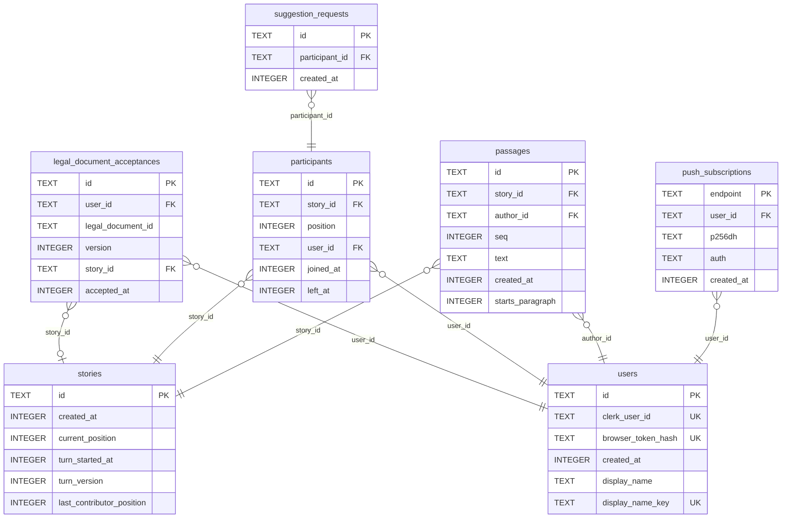

# Database

> Generated by `pnpm db:docs` from the migrations and `src/worker/db/tableSchemas.ts`. Do not edit it by hand.
>
> Descriptions come from the table schemas; columns, types, keys and indexes come from the migrated database.
>
> Required counts a primary key as required, as the app does; SQLite lets a non-INTEGER primary key hold NULL.
>
> Times are integer milliseconds since the Unix epoch (epoch ms).



## legal_document_acceptances

One row per legal document acceptance: a user's recorded yes to one version of one legal document. Append-only, so a new version means a new row and old rows stay as the record of what each user agreed to. user_id changes only when two users merge.

### Columns

| Column              | Type    | Required | Default | Description                                                                                             |
| ------------------- | ------- | -------- | ------- | ------------------------------------------------------------------------------------------------------- |
| `id`                | TEXT    | yes      |         | Opaque ID of the legal document acceptance.                                                             |
| `user_id`           | TEXT    | yes      |         | The user who accepted the legal document.                                                               |
| `legal_document_id` | TEXT    | yes      |         | ID of the legal document, as in LEGAL_DOCUMENTS: terms-of-service or copyright-terms/<copyright model>. |
| `version`           | INTEGER | yes      |         | The version of the legal document that was accepted.                                                    |
| `story_id`          | TEXT    | no       |         | The story a per-story legal document was accepted for; null for one accepted per user.                  |
| `accepted_at`       | INTEGER | yes      |         | When the user accepted it, in epoch ms.                                                                 |

### Indexes

| Name                                            | Kind        | Columns | Condition |
| ----------------------------------------------- | ----------- | ------- | --------- |
| `legal_document_acceptances_by_user_id`         | index       | user_id |           |
| `sqlite_autoindex_legal_document_acceptances_1` | primary key | id      |           |

<details>
<summary>CREATE TABLE statement</summary>

```sql
CREATE TABLE legal_document_acceptances (
  id TEXT PRIMARY KEY,
  user_id TEXT NOT NULL REFERENCES users (id),
  legal_document_id TEXT NOT NULL,
  version INTEGER NOT NULL,
  story_id TEXT REFERENCES stories (id),
  accepted_at INTEGER NOT NULL
)
```

</details>

## participants

One row per user who joins a story. A leaver's row stays, so the story keeps its turn order and the user keeps their place if they rejoin. After a merge, a user can also hold a left row in a story they are in.

### Columns

| Column      | Type    | Required | Default | Description                                                                                            |
| ----------- | ------- | -------- | ------- | ------------------------------------------------------------------------------------------------------ |
| `id`        | TEXT    | yes      |         | Opaque ID of the participant.                                                                          |
| `story_id`  | TEXT    | yes      |         | The story the participant joined.                                                                      |
| `position`  | INTEGER | yes      |         | Place in the turn order, unique in the story; a leaver keeps theirs, and a rejoin gets a new last one. |
| `user_id`   | TEXT    | yes      |         | The user this participant belongs to.                                                                  |
| `joined_at` | INTEGER | yes      |         | When the participant first joined, in epoch ms; a rejoin keeps it.                                     |
| `left_at`   | INTEGER | no       |         | When the participant left the story, in epoch ms; null while they are in it.                           |

### Indexes

| Name                              | Kind              | Columns            | Condition         |
| --------------------------------- | ----------------- | ------------------ | ----------------- |
| `participants_active_by_user`     | unique index      | story_id, user_id  | `left_at IS NULL` |
| `participants_by_user`            | index             | user_id            |                   |
| `sqlite_autoindex_participants_1` | primary key       | id                 |                   |
| `sqlite_autoindex_participants_2` | unique constraint | story_id, position |                   |

<details>
<summary>CREATE TABLE statement</summary>

```sql
CREATE TABLE participants (
  id TEXT PRIMARY KEY,
  story_id TEXT NOT NULL REFERENCES stories (id),
  position INTEGER NOT NULL,
  user_id TEXT NOT NULL REFERENCES users (id),
  joined_at INTEGER NOT NULL,
  left_at INTEGER,
  UNIQUE (story_id, position)
)
```

</details>

## passages

Every passage of a story. Append-only: the app never edits or deletes the text, and author_id changes only when two users merge.

### Columns

| Column             | Type    | Required | Default | Description                                                              |
| ------------------ | ------- | -------- | ------- | ------------------------------------------------------------------------ |
| `id`               | TEXT    | yes      |         | Opaque ID of the passage.                                                |
| `story_id`         | TEXT    | yes      |         | The story the passage belongs to.                                        |
| `author_id`        | TEXT    | yes      |         | The user who wrote it, its author.                                       |
| `seq`              | INTEGER | yes      |         | Place in the story, 1 for the opening, unique within the story.          |
| `text`             | TEXT    | yes      |         | The text of the passage.                                                 |
| `created_at`       | INTEGER | yes      |         | When the passage was written, in epoch ms.                               |
| `starts_paragraph` | INTEGER | yes      | `1`     | 1 if the passage begins a new paragraph, 0 if it continues the last one. |

### Indexes

| Name                          | Kind              | Columns       | Condition |
| ----------------------------- | ----------------- | ------------- | --------- |
| `passages_by_author`          | index             | author_id     |           |
| `sqlite_autoindex_passages_1` | primary key       | id            |           |
| `sqlite_autoindex_passages_2` | unique constraint | story_id, seq |           |

<details>
<summary>CREATE TABLE statement</summary>

```sql
CREATE TABLE passages (
  id TEXT PRIMARY KEY,
  story_id TEXT NOT NULL REFERENCES stories (id),
  author_id TEXT NOT NULL REFERENCES users (id),
  seq INTEGER NOT NULL,
  text TEXT NOT NULL,
  created_at INTEGER NOT NULL,
  starts_paragraph INTEGER NOT NULL DEFAULT 1 CHECK (starts_paragraph IN (0, 1)),
  UNIQUE (story_id, seq)
)
```

</details>

## push_subscriptions

A browser's Web Push subscription, one per push service endpoint. It belongs to a user, not a story, and covers every story the user is in.

### Columns

| Column       | Type    | Required | Default | Description                                                        |
| ------------ | ------- | -------- | ------- | ------------------------------------------------------------------ |
| `endpoint`   | TEXT    | yes      |         | Web Push endpoint of the subscription.                             |
| `user_id`    | TEXT    | yes      |         | The user the subscription belongs to.                              |
| `p256dh`     | TEXT    | yes      |         | The browser's public key, used to encrypt each message, base64url. |
| `auth`       | TEXT    | yes      |         | Authentication secret used to encrypt each message, base64url.     |
| `created_at` | INTEGER | yes      |         | When the subscription was first stored, in epoch ms.               |

### Indexes

| Name                                    | Kind        | Columns  | Condition |
| --------------------------------------- | ----------- | -------- | --------- |
| `push_subscriptions_by_user`            | index       | user_id  |           |
| `sqlite_autoindex_push_subscriptions_1` | primary key | endpoint |           |

<details>
<summary>CREATE TABLE statement</summary>

```sql
CREATE TABLE "push_subscriptions" (
  endpoint TEXT PRIMARY KEY,
  user_id TEXT NOT NULL REFERENCES users (id),
  -- The browser's public key and authentication secret, base64url, used to encrypt each message.
  p256dh TEXT NOT NULL,
  auth TEXT NOT NULL,
  created_at INTEGER NOT NULL
)
```

</details>

## stories

One row per story. The turn fields hold the turn as last saved: an expired window moves the turn only on the next write, so read them through resolveTurn. A waiting story has no turn holder, so its current position and turn start are null.

### Columns

| Column                      | Type    | Required | Default | Description                                                                                                      |
| --------------------------- | ------- | -------- | ------- | ---------------------------------------------------------------------------------------------------------------- |
| `id`                        | TEXT    | yes      |         | Five-character story ID of lowercase letters and digits, also its URL path (/<id>).                              |
| `created_at`                | INTEGER | yes      |         | When the story was created, in epoch ms.                                                                         |
| `current_position`          | INTEGER | no       |         | Position of the turn holder; null while the story is waiting.                                                    |
| `turn_started_at`           | INTEGER | no       |         | When the current turn began, in epoch ms; null while the story is waiting.                                       |
| `turn_version`              | INTEGER | yes      | `0`     | Starts at 0 and goes up by one on each contribution, skip, expired window, join, rejoin and leave.               |
| `last_contributor_position` | INTEGER | no       |         | Position of the last contributor, whom the turn passes over. Set from the opening on, so never null in practice. |

### Indexes

| Name                         | Kind        | Columns | Condition |
| ---------------------------- | ----------- | ------- | --------- |
| `sqlite_autoindex_stories_1` | primary key | id      |           |

<details>
<summary>CREATE TABLE statement</summary>

```sql
CREATE TABLE stories (
  id TEXT PRIMARY KEY CHECK (length(id) = 5),
  created_at INTEGER NOT NULL,
  -- NULL means the story is waiting for a joiner.
  current_position INTEGER,
  turn_started_at INTEGER,
  turn_version INTEGER NOT NULL DEFAULT 0,
  last_contributor_position INTEGER
)
```

</details>

## suggestion_requests

One row per suggestion request. Rows newer than SUGGESTION_WINDOW_MS count towards the participant's SUGGESTION_LIMIT. The app deletes a row only when the AI provider errors; a timeout or unusable reply still counts.

### Columns

| Column           | Type    | Required | Default | Description                                |
| ---------------- | ------- | -------- | ------- | ------------------------------------------ |
| `id`             | TEXT    | yes      |         | Opaque ID of the request.                  |
| `participant_id` | TEXT    | yes      |         | The participant who asked for suggestions. |
| `created_at`     | INTEGER | yes      |         | When the request was made, in epoch ms.    |

### Indexes

| Name                                      | Kind        | Columns                    | Condition |
| ----------------------------------------- | ----------- | -------------------------- | --------- |
| `sqlite_autoindex_suggestion_requests_1`  | primary key | id                         |           |
| `suggestion_requests_by_participant_time` | index       | participant_id, created_at |           |

<details>
<summary>CREATE TABLE statement</summary>

```sql
CREATE TABLE suggestion_requests (
  id TEXT PRIMARY KEY,
  participant_id TEXT NOT NULL REFERENCES participants (id),
  created_at INTEGER NOT NULL
)
```

</details>

## users

One row per user, found by the hash of its device token or by its Clerk user ID. Passages, participants and push subscriptions belong to a user, and so does the display name.

### Columns

| Column               | Type    | Required | Default | Description                                                                                                            |
| -------------------- | ------- | -------- | ------- | ---------------------------------------------------------------------------------------------------------------------- |
| `id`                 | TEXT    | yes      |         | Opaque ID of the user.                                                                                                 |
| `clerk_user_id`      | TEXT    | no       |         | Clerk user ID of the user's account; null for an anonymous user.                                                       |
| `browser_token_hash` | TEXT    | no       |         | Hex SHA-256 hash of the device token; null for an account user.                                                        |
| `created_at`         | INTEGER | yes      |         | When the user was created, in epoch ms.                                                                                |
| `display_name`       | TEXT    | no       |         | Name shown beside the user's passages in every story; null until the user starts or joins a story.                     |
| `display_name_key`   | TEXT    | no       |         | The display name trimmed, NFKC-normalised and case-folded; unique across users. Null exactly when the display name is. |

### Indexes

| Name                        | Kind              | Columns            | Condition |
| --------------------------- | ----------------- | ------------------ | --------- |
| `sqlite_autoindex_users_1`  | primary key       | id                 |           |
| `sqlite_autoindex_users_2`  | unique constraint | clerk_user_id      |           |
| `sqlite_autoindex_users_3`  | unique constraint | browser_token_hash |           |
| `users_by_display_name_key` | unique index      | display_name_key   |           |

<details>
<summary>CREATE TABLE statement</summary>

```sql
CREATE TABLE users (
  id TEXT PRIMARY KEY,
  clerk_user_id TEXT UNIQUE,
  browser_token_hash TEXT UNIQUE,
  created_at INTEGER NOT NULL, display_name TEXT, display_name_key TEXT
  CHECK ((display_name IS NULL) = (display_name_key IS NULL)),
  CHECK (clerk_user_id IS NOT NULL OR browser_token_hash IS NOT NULL)
)
```

</details>
